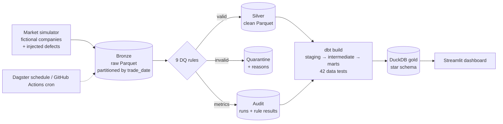
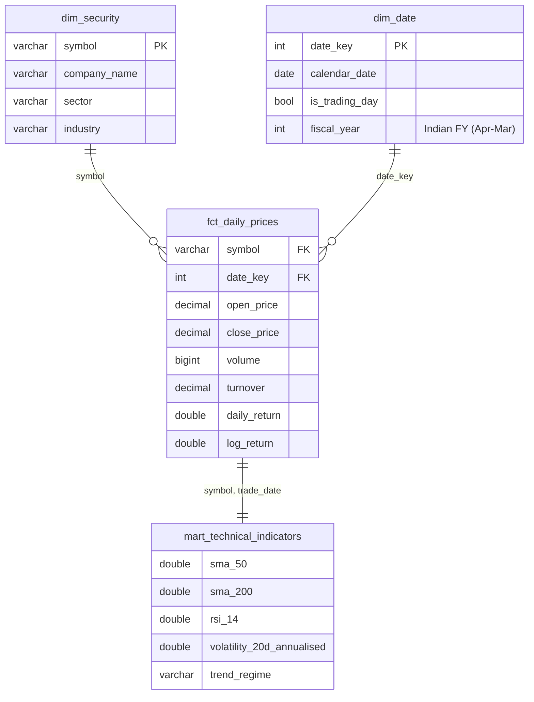
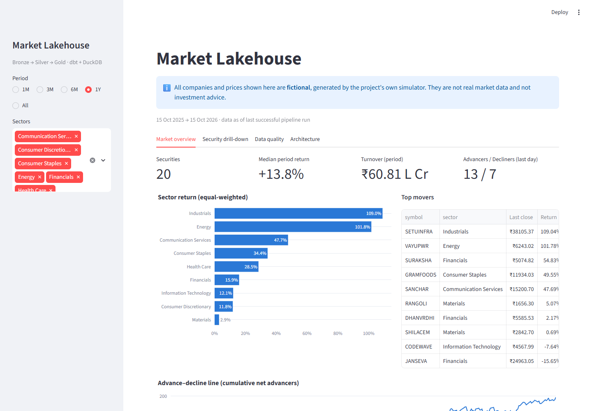
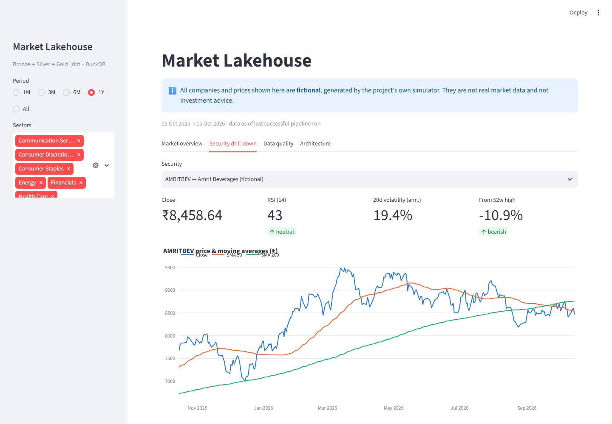
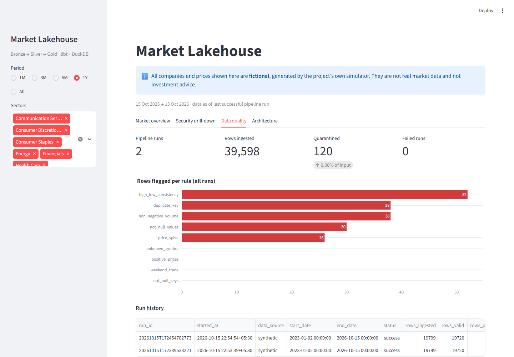

# Market Lakehouse: equities data platform


An end-to-end, **incremental, tested, observable** data platform for an Indian-style stock market. It ingests daily OHLCV bars from a built-in market simulator, enforces data-quality contracts with row-level quarantine, models a **star schema in dbt on DuckDB**, and serves analytics through a Streamlit dashboard.

A full multi-year backfill runs on a laptop in about a minute with **zero cost and zero third-party data**. The same layered design maps directly onto S3 + Snowflake/Databricks in production.

```
lakehouse run --start 2023-01-02 --end 2026-10-14

Bronze: 19774 rows landed
Silver: 19700 valid | 60 quarantined | 14 duplicates dropped
dbt build ... PASS=42 WARN=0 ERROR=0
```

---

## Why this project exists

Real market-data feeds are messy: missing closes, negative volumes, swapped high/low, 100× unit errors, duplicate deliveries. This project treats those as first-class engineering problems rather than assuming clean input:

| Problem | How it's solved here |
|---|---|
| Re-running a load must not double-count | Idempotent partition overwrite in silver + `delete+insert` incremental fact in dbt |
| Daily runs shouldn't reprocess history | Watermark-based incremental extraction + dbt lookback window |
| Bad rows shouldn't break the pipeline *or* reach reports | Declarative DQ rules → quarantine with reasons; audit trail per run |
| "Is the data trustworthy today?" | DQ metrics modelled in dbt (`mart_data_quality`) and shown on a dashboard tab |
| Works offline, in CI, with no licensing risk | Built-in deterministic market simulator behind a pluggable `PriceSource` interface |

## Data & licensing

**Every number in this project is generated by the project's own code** ([src/lakehouse/ingest/synthetic.py](src/lakehouse/ingest/synthetic.py)).

- The 20 companies in [dbt/seeds/securities.csv](dbt/seeds/securities.csv) are **fictional**, and each name is marked "(fictional)". Any resemblance to a real company is coincidental.
- Prices follow a standard random-walk model (geometric Brownian motion). They are not copied from, derived from, or calibrated against any exchange, vendor, or website.
- No API keys, no scraping, no downloads, no third-party terms of service. The project runs fully offline.
- The data is not real market data and is not investment advice.

Simulated data is a deliberate engineering choice, not a shortcut. It is reproducible bit-for-bit, so the tests can prove idempotency. It also lets realistic vendor-feed defects be injected at a known rate, so the data-quality layer is tested against known answers.

## Architecture



| Layer | Tech | Responsibility |
|---|---|---|
| Ingestion | Python, pandas, PyArrow | Connector interface, watermark, Hive-partitioned Parquet |
| Data quality | Custom rule engine | Vectorised rules, quarantine, per-run audit |
| Transformation | dbt-core + dbt-duckdb | Staging/intermediate/marts, incremental fact, generic + singular tests |
| Warehouse | DuckDB | Columnar OLAP engine reading Parquet directly |
| Serving | Streamlit + Plotly | Market overview, technical drill-down, data-quality monitoring |
| Orchestration | Dagster (optional), GitHub Actions cron | Asset graph + weekday schedule at 19:00 IST |
| CI/CD | GitHub Actions | Lint, unit + e2e tests, full pipeline run, dbt docs |

## Data model (gold layer)



| Model | Materialisation | Notes |
|---|---|---|
| `stg_prices` | view | Typing + dedupe with `QUALIFY ROW_NUMBER()` (latest ingest wins) |
| `int_prices_enriched` | view | `LAG()` window: returns, log returns, gaps, intraday range |
| `fct_daily_prices` | **incremental** | Grain = symbol × day; `delete+insert`, 7-day lookback |
| `dim_security`, `dim_date` | table | Conformed dimensions; Indian fiscal year |
| `mart_technical_indicators` | table | SMA 20/50/200, RSI-14, 20d annualised vol, 52-week range, golden-cross regime |
| `mart_sector_daily` | table | Equal-weight sector returns, breadth (advancers/decliners), top movers via `arg_max` |
| `mart_data_quality` | table | Run × rule pass rates for observability |

## Data quality rules

| Rule | Severity | Catches |
|---|---|---|
| `not_null_values` | error | Missing OHLC / volume |
| `not_null_keys` | error | Missing symbol or date |
| `positive_prices` | error | Zero / negative prices |
| `non_negative_volume` | error | Sign errors |
| `high_low_consistency` | error | Swapped or impossible high/low |
| `price_spike` | error | >40% deviation from a 5-bar local median, using **silver history as context** so it works on single-day incremental batches |
| `weekend_trade` | error | Bars on non-trading days |
| `unknown_symbol` | error | Symbols missing from the security master |
| `duplicate_key` | warn | Re-delivered rows (dropped, counted, not quarantined) |

Then dbt tests add a second line of defence on the modelled data: uniqueness of grain, referential integrity between fact and dimensions, accepted values, RSI ∈ [0, 100], |daily return| ≤ 50%, coherent OHLC, and no future dates.

## Quickstart

Requires **Python 3.10+** only. Everything installs into a local virtual environment (`.venv`) inside the project folder, so nothing is installed system-wide.

### Windows (double-click)

| Script | What it does |
|---|---|
| `setup.bat` | Creates `.venv`, installs dependencies, builds the warehouse (first run: a few minutes) |
| `dashboard.bat` | Opens the dashboard at http://localhost:8501 |
| `update.bat` | Incremental load: picks up from the last loaded date |

### Manual (any OS)

```bash
python -m venv .venv
# Windows:  .venv\Scriptsctivate
# macOS/Linux:  source .venv/bin/activate
pip install -e ".[dashboard,dev]"

lakehouse run --start 2023-01-02     # backfill
lakehouse run                        # incremental: resumes from the watermark
lakehouse dashboard                  # http://localhost:8501
pytest                               # 17 tests: unit, end-to-end, dashboard smoke test
```

### Optional extras

```bash
pip install -e ".[orchestration]"
dagster dev -f orchestration/definitions.py   # Dagster UI at http://localhost:3000

cd dbt && dbt docs generate && dbt docs serve # dbt docs + lineage graph
```

| Variable | Default | Purpose |
|---|---|---|
| `LAKEHOUSE_DATA_DIR` | `./data` | Root for bronze/silver/quarantine/audit |
| `LAKEHOUSE_WAREHOUSE` | `./data/warehouse.duckdb` | DuckDB file |
| `LAKEHOUSE_START_DATE` | `2024-01-01` | First-run start when no watermark exists |

## Design decisions

- **Synthetic data is deterministic and range-independent.** Each bar is seeded from a fixed epoch per symbol, so a backfill and a sequence of daily incrementals produce *identical* data. That is what makes the end-to-end idempotency tests possible. Defects are injected at a controlled ~0.4% rate so the DQ layer is exercised on every run.
- **Quarantine instead of fail-fast.** One bad row from a vendor shouldn't block 19,000 good ones. Bad rows are kept with every failing rule listed, so they can be fixed and replayed.
- **Two lines of defence.** Python rules guard the *input contract*. dbt tests guard the *modelled output* (grain, referential integrity, business invariants).
- **dbt runs in a subprocess.** This guarantees DuckDB's single-writer lock is released before readers (dashboard, tests) connect.
- **Parquet + DuckDB locally, cloud-portable by design.** Swap the paths for `s3://` and the dbt adapter for Snowflake and the layering is unchanged.

## Project structure

```
src/lakehouse/
  ingest/          # PriceSource interface + market simulator
  quality.py       # declarative DQ rules + quarantine
  storage.py       # partitioned Parquet IO, idempotent overwrite, watermark
  pipeline.py      # stage functions shared by CLI, tests, and Dagster
  cli.py           # `lakehouse run | transform | dashboard`
dbt/
  models/staging | intermediate | marts
  macros/          # generic tests (unique_combination, value_between), schema naming
  tests/           # singular tests
  seeds/           # security master
dashboard/app.py   # Streamlit
orchestration/     # Dagster assets + schedule
tests/             # pytest: unit, e2e (backfill → incremental → no-op → idempotent rerun)
```

## Roadmap

- [ ] Corporate actions (splits/bonuses) as an SCD Type 2 dimension and adjusted prices
- [ ] Simulated corporate events (dividends, earnings gaps, circuit-limit halts)
- [ ] Swap target to Snowflake via `dbt-snowflake` and S3 storage
- [ ] Alerting (Slack/email) when quarantine rate exceeds a threshold

## Screenshots

**Market overview**: sector returns, top movers, market breadth



**Security drill-down**: price with SMA 50/200, RSI, volatility



**Data quality**: rows flagged per rule and run history



A plain-English explanation of the project is in [docs/Market_Lakehouse_Explained.docx](docs/Market_Lakehouse_Explained.docx).

---

*All companies and prices are fictional and generated by this project. Not financial advice.*
